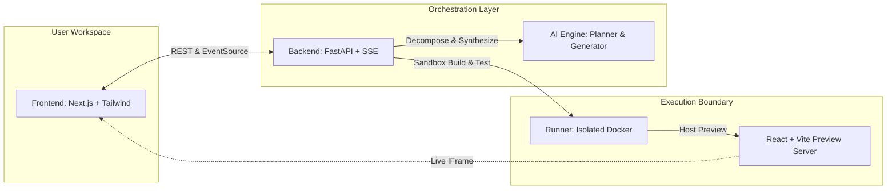

# HackMate — Autonomous Agentic AI Hackathon Platform

> **Transform hackathon ideas into functional, testable React + Vite prototypes in minutes.**

HackMate is an agentic AI system architected for rapid hackathon execution. It automates the full engineering pipeline: breaking down project prompts into concrete tasks, generating idiomatic source code, building the bundle inside an isolated sandbox, and rendering live interactive previews.

---

## Architecture Overview



### Core Architecture Flow
1. **Idea Intake:** User inputs a hackathon prompt (10–2000 characters).
2. **Decomposition (Planner):** The AI planner analyzes requirements and generates ordered development tasks.
3. **Synthesis (Generator):** The AI code generator produces a complete React + Vite application file tree.
4. **Sandboxed Compilation (Runner):** An isolated Docker container installs dependencies and builds the project without risking host security.
5. **Real-time SSE Streaming:** Live progress, agent statuses, and compiler logs stream back to the dashboard.
6. **Instant Preview:** The user interacts with the generated application in an embedded live preview.

---

## MVP Scope

- **Target Generation Framework:** React 18+ with Vite (exclusive MVP target).
- **Security Boundary:** Zero host execution. All build tasks execute in non-privileged Docker containers.
- **Contract Driven:** Shared OpenAPI 3.1 and JSON schemas define all models across teams.
- **Offline / Mock Fallback:** When external LLM APIs are not provided, deterministic mock engines ensure end-to-end functionality.

---

## Repository Structure

```text
HACKMATE/
├── README.md               # Root project documentation
├── .gitignore              # Ignores venvs, node_modules, build outputs, secrets
├── .editorconfig           # Consistent formatting rules
├── .gitattributes          # Line ending normalization
├── .env.example            # Environment variables template
├── docker-compose.yml      # Local multi-service orchestrator
├── Makefile                # Cross-platform shortcuts
├── docs/                   # Authoritative architecture and team guides
│   ├── ARCHITECTURE.md     # Sequence diagrams and component deep dives
│   ├── API_CONTRACT.md     # Authoritative REST and SSE contracts
│   ├── DATA_MODELS.md      # Shared schemas and state machines
│   ├── DEVELOPMENT.md      # Local setup and PowerShell guides
│   └── TEAM_OWNERSHIP.md   # Sprint responsibilities & branch ownership
├── contracts/              # Single source of truth specifications
│   ├── README.md           # Schema guide
│   ├── openapi.yaml        # OpenAPI 3.1 specification for all 8 endpoints
│   ├── project.schema.json # Project schema
│   ├── task.schema.json    # Task schema
│   ├── generated-file.schema.json # File schema
│   └── agent-event.schema.json    # SSE event schema
├── frontend/               # Next.js 15 + React 19 + Tailwind CSS dashboard
├── backend/                # FastAPI + Pydantic + Uvicorn service
├── ai/                     # Planner & generator agents
├── runner/                 # Sandboxed Docker compilation & preview worker
├── generated/              # Sandboxed output directory (.gitkeep)
└── scripts/                # Development and verification PowerShell scripts
    ├── dev.ps1             # Local development launcher
    └── check.ps1           # Integrity and validation script
```

---

## Team Ownership & Parallel Branches

| Person | Focus Area | Directory Scope | Working Branch | Key Deliverable |
| :--- | :--- | :--- | :--- | :--- |
| **Person 1** | **Frontend** | `frontend/` | `feature/frontend` | Next.js Dashboard, SSE streaming listener, code inspector, live preview frame. |
| **Person 2** | **Backend** | `backend/`, `contracts/` | `feature/backend` | FastAPI REST & SSE endpoints, project state transitions, repository abstraction. |
| **Person 3** | **AI Agents** | `ai/` | `feature/ai` | Prompt engineering for `planner.py` & `generator.py`, schema validation. |
| **Person 4** | **Sandbox / QA** | `runner/` | `feature/sandbox` | Docker build runner, npm compilation, security constraints, smoke tests. |

---

## Authoritative API Endpoints

All endpoints are prefixed under `/api`:

| Method | Endpoint | Description |
| :--- | :--- | :--- |
| `GET` | `/api/health` | Health check and service readiness |
| `POST` | `/api/projects` | Register new hackathon project idea |
| `GET` | `/api/projects/{id}` | Retrieve stored project details |
| `POST` | `/api/projects/{id}/start` | Trigger autonomous planning and generation |
| `GET` | `/api/projects/{id}/tasks` | Retrieve decomposed project subtasks |
| `GET` | `/api/projects/{id}/events` | Real-time Server-Sent Events (SSE) stream |
| `GET` | `/api/projects/{id}/files` | Retrieve synthesized React + Vite files |
| `GET` | `/api/projects/{id}/preview` | Retrieve runner build logs and preview URL |

---

## Prerequisites

- **Node.js**: v20+ LTS or v24+
- **Python**: 3.11+
- **Docker & Docker Compose** (for containerized runner execution)
- **Git**

---

## Quick Start

### Option A: Using Docker Compose
```powershell
docker compose up --build
```
Access dashboard at [http://localhost:3000](http://localhost:3000) and API docs at [http://localhost:8000/docs](http://localhost:8000/docs).

### Option B: Local Development

#### 1. Backend Service
```powershell
cd backend
python -m venv .venv
.\.venv\Scripts\Activate.ps1
pip install -r requirements.txt
uvicorn app.main:app --reload --port 8000
```

#### 2. Frontend Dashboard
```powershell
cd frontend
npm.cmd install
npm.cmd run dev
```

---

## Verification

Run the comprehensive sanity check script:
```powershell
powershell -ExecutionPolicy Bypass -File .\scripts\check.ps1
```
