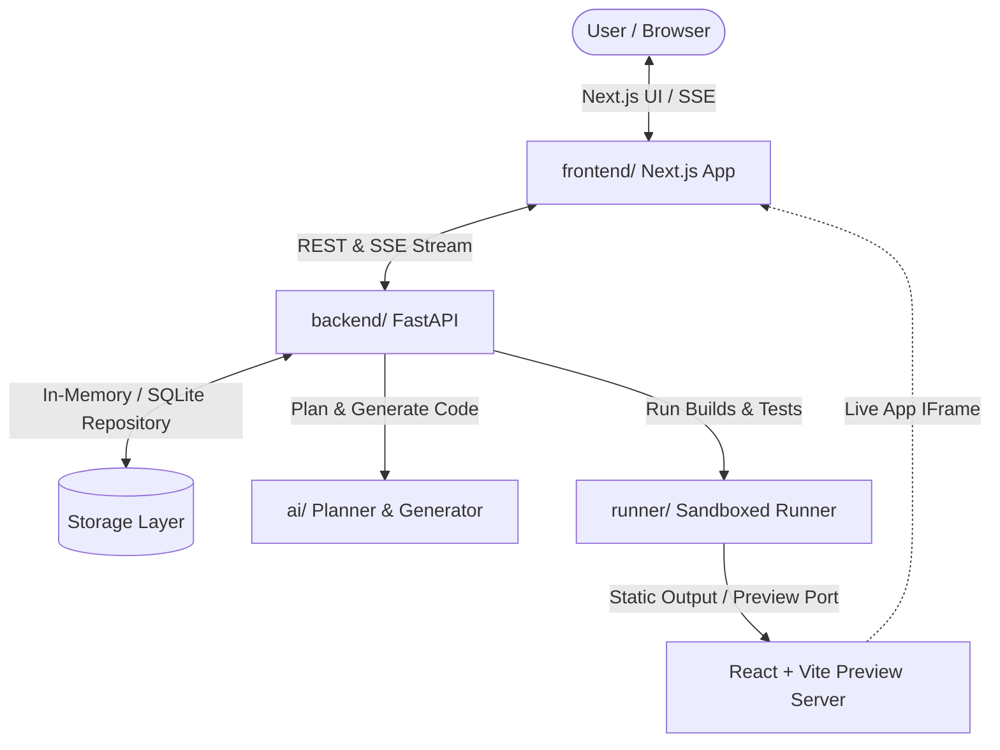
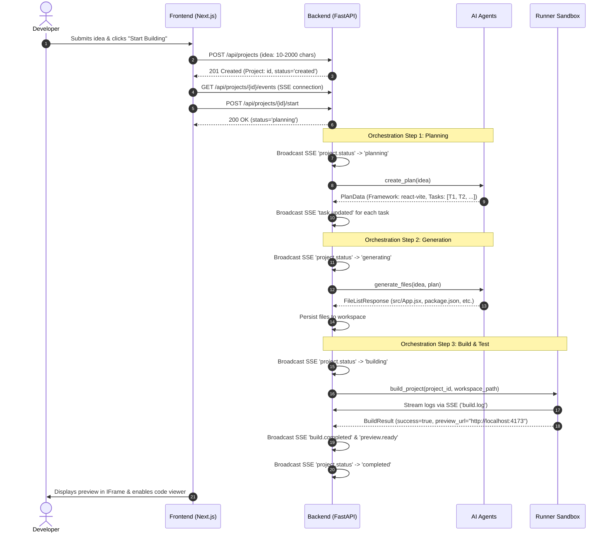

# HackMate Architecture

This document describes the high-level system architecture, request flow, component interactions, and execution lifecycle of **HackMate**.

---

## 1. System Overview

HackMate is an agentic AI hackathon companion designed to take a high-level project idea and autonomously produce, build, test, and preview a working React + Vite application within minutes.

---

## 2. Component Roles

| Component | Technology | Primary Responsibility |
| :--- | :--- | :--- |
| **Frontend** (`frontend/`) | Next.js 15, React 19, TypeScript, Tailwind CSS | Dashboard UI, idea submission, real-time agent/build log feeds, code inspection, interactive preview. |
| **Backend** (`backend/`) | Python 3.11+, FastAPI, Pydantic, Uvicorn | Project management, SSE event multiplexing, orchestrator triggering, API contract enforcement. |
| **AI Agents** (`ai/`) | Python, LangChain / Direct SDKs (OpenAI/Gemini/Anthropic) | Prompt decomposition into tasks (`planner.py`) and code synthesis (`generator.py`). |
| **Runner** (`runner/`) | Docker, Python, Node.js / Vite | Isolated environment executing `npm install`, `npm run build`, and preview hosting. |
| **Contracts** (`contracts/`) | OpenAPI 3.1, JSON Schemas | Single source of truth for all schemas and endpoint contracts. |

---

## 3. End-to-End Execution Flow

---

## 4. Security & Sandbox Boundary

1. **Isolation Guarantee:** Generated code is never executed directly on the host operating system. Build and execution runs within an isolated Docker container with dropped privileges (`no-new-privileges:true`), CPU/memory limits, and restricted networking.
2. **Read-Only Code Integrity:** Workspace files are validated prior to execution to prevent path traversal (`../`) attacks outside the project's generated sandbox folder.
3. **Graceful Fallbacks:** In development environments without active LLM keys or Docker daemon access, both the AI agent module and the Runner module provide deterministic mock responses for end-to-end testing.
